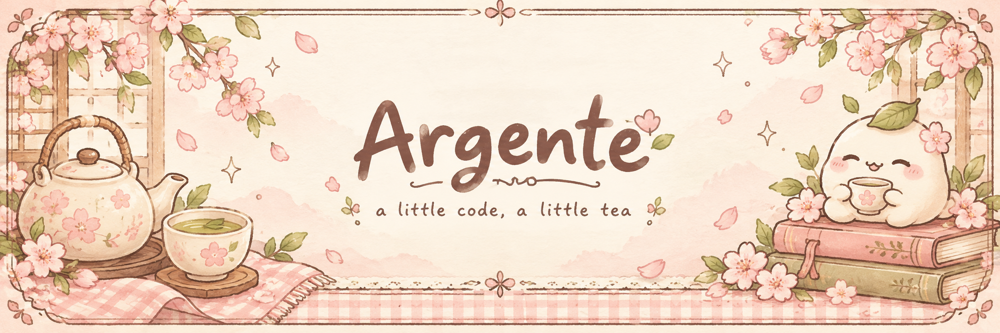

 

### 🌸 어서 오세요, Argente의 작은 티룸입니다

따뜻한 차 한 잔과 함께, 배운 것을 차곡차곡 기록해요.

 

  

🌷 **작은 기록들이 모이는 곳**

알고리즘 문제 풀이와 풀이 과정의 기록을 담고 있어요.

[🍵 백준 풀이 노트 보러 가기](https://github.com/Argente0810/BAEKJOON__ONLINE_JUDGE)

 

─── ✿ ───

a little code, a little tea · Argente0810

